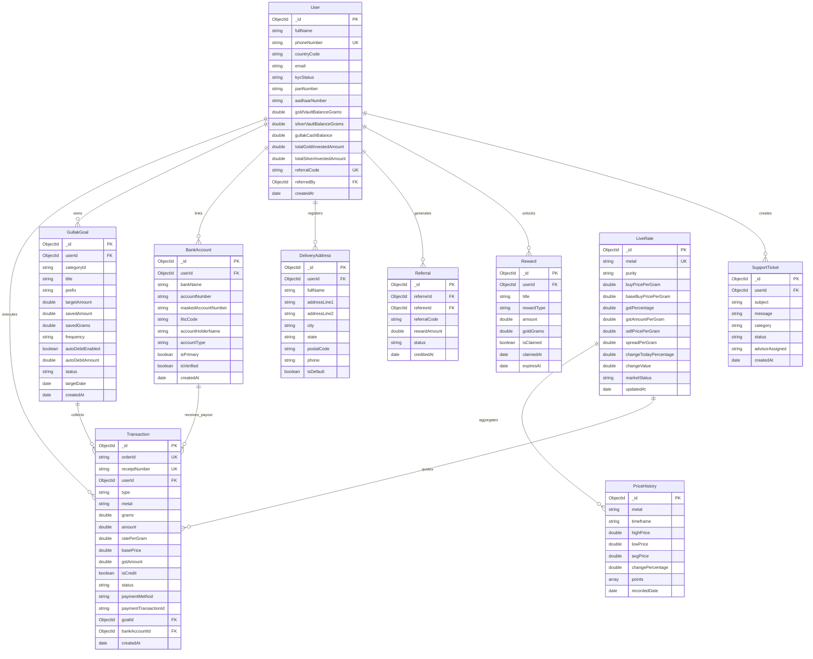
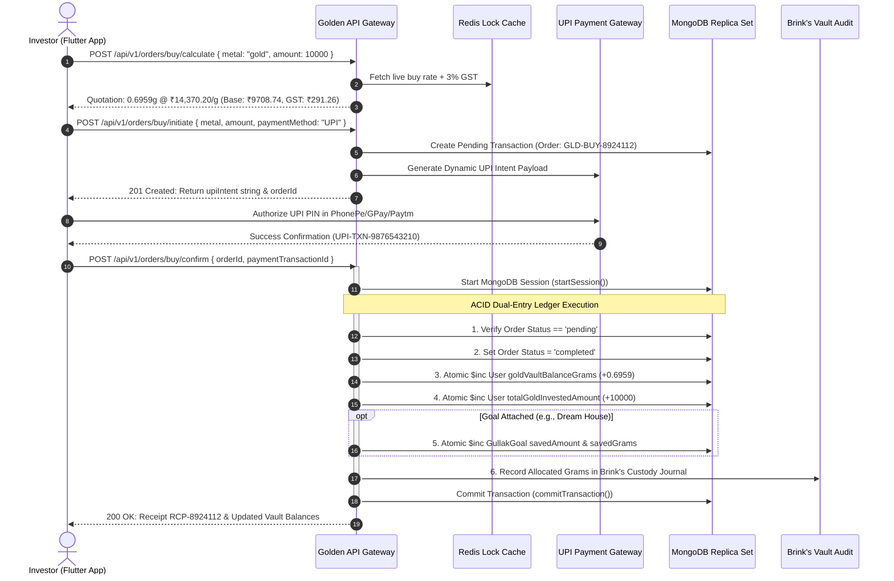
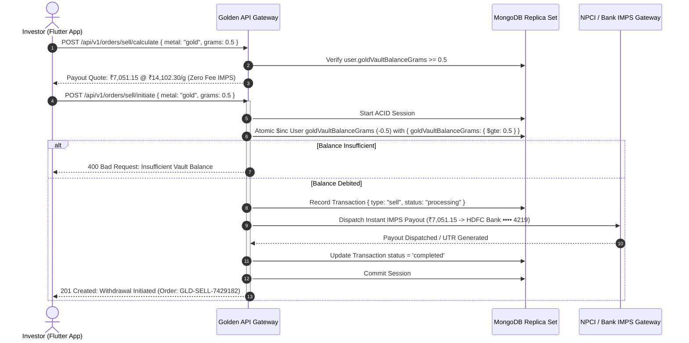

# GOLDEN DIGITAL PRECIOUS METALS PLATFORM
## Comprehensive Backend REST API Architecture & Integration Specification
**Production-Ready Node.js / Express / MongoDB Ecosystem**  
**Document Version:** `1.0.0` | **Effective Date:** `October 31, 2026` | **Target Client:** Flutter / Web / Microservices

---

## Table of Contents
1. [Executive Architectural Overview](#1-executive-architectural-overview)
   - [1.1 Platform Architectural Topology](#11-platform-architectural-topology)
   - [1.2 Global Network & Environment Configurations](#12-global-network--environment-configurations)
   - [1.3 Protocol Standards & Security Architecture](#13-protocol-standards--security-architecture)
   - [1.4 Standard JSON Response Envelope Standard](#14-standard-json-response-envelope-standard)
2. [Database Schema & Entity-Relationship Architecture](#2-database-schema--entity-relationship-architecture)
   - [2.1 High-Level Entity-Relationship Diagram](#21-high-level-entity-relationship-diagram)
   - [2.2 Detailed Mongoose Collection Specifications](#22-detailed-mongoose-collection-specifications)
3. [Core Financial State Machines & Business Logic Workflows](#3-core-financial-state-machines--business-logic-workflows)
   - [3.1 Buy Order Lifecycle & Atomic Vault Allocation](#31-buy-order-lifecycle--atomic-vault-allocation)
   - [3.2 Sell Order Execution & Instant Bank Payout (IMPS)](#32-sell-order-execution--instant-bank-payout-imps)
   - [3.3 5-Minute Price Lock Guarantee Engine](#33-5-minute-price-lock-guarantee-engine)
   - [3.4 Statutory 3.0% GST & HSN Tax Accounting Rules](#34-statutory-30-gst--hsn-tax-accounting-rules)
4. [Complete API Endpoint Reference Specification](#4-complete-api-endpoint-reference-specification)
   - [Module 1: Authentication & Identity Management](#module-1-authentication--identity-management)
     - `POST /api/v1/auth/send-otp`
     - `POST /api/v1/auth/verify-otp`
     - `GET /api/v1/user/profile`
     - `POST /api/v1/user/kyc/submit`
   - [Module 2: Live Rates, Market Data & Historical Trajectory](#module-2-live-rates-market-data--historical-trajectory)
     - `GET /api/v1/rates/live`
     - `POST /api/v1/rates/lock-quote`
     - `GET /api/v1/rates/history`
   - [Module 3: Bullion Buy Orders & Checkout Pipeline](#module-3-bullion-buy-orders--checkout-pipeline)
     - `POST /api/v1/orders/buy/calculate`
     - `POST /api/v1/orders/buy/initiate`
     - `POST /api/v1/orders/buy/confirm`
   - [Module 4: Bullion Sell & Instant Bank Withdrawal](#module-4-bullion-sell--instant-bank-withdrawal)
     - `POST /api/v1/orders/sell/calculate`
     - `POST /api/v1/orders/sell/initiate`
   - [Module 5: Gullak Micro-Savings & Savings Goals Engine](#module-5-gullak-micro-savings--savings-goals-engine)
     - `GET /api/v1/gullak/catalog`
     - `GET /api/v1/gullak/goals`
     - `POST /api/v1/gullak/goals`
     - `POST /api/v1/gullak/goals/:id/deposit`
   - [Module 6: Portfolio Analytics & Asset Holdings](#module-6-portfolio-analytics--asset-holdings)
     - `GET /api/v1/portfolio/summary`
     - `GET /api/v1/portfolio/metal/:metalType`
   - [Module 7: Financial Ledger & Tax Invoices](#module-7-financial-ledger--tax-invoices)
     - `GET /api/v1/transactions`
     - `GET /api/v1/transactions/:id/invoice`
   - [Module 8: Banking & Instant Payout Accounts](#module-8-banking--instant-payout-accounts)
     - `POST /api/v1/bank-accounts`
   - [Module 9: Viral Growth, Referrals & Rewards Engine](#module-9-viral-growth-referrals--rewards-engine)
     - `GET /api/v1/referrals/my-code`
     - `GET /api/v1/rewards`
   - [Module 10: 24/7 Gold Advisor Support & Institutional Trust](#module-10-247-gold-advisor-support--institutional-trust)
     - `POST /api/v1/support/ticket`
     - `GET /api/v1/support/faqs`
5. [Client-Side Integration Guide (Flutter / Dart)](#5-client-side-integration-guide-flutter--dart)
   - [5.1 Production Dio HTTP Client Configuration](#51-production-dio-http-client-configuration)
   - [5.2 JWT Token Refresh & Auth Interceptor](#52-jwt-token-refresh--auth-interceptor)
   - [5.3 Live Rate Polling & Price Lock Coordination](#53-live-rate-polling--price-lock-coordination)
6. [Unified Error Taxonomy & Exception Matrix](#6-unified-error-taxonomy--exception-matrix)
7. [Security, Brink's Vaulting & Regulatory Compliance](#7-security-brinks-vaulting--regulatory-compliance)

---

## 1. Executive Architectural Overview

The **Golden Digital Precious Metals Platform** delivers institutional-grade digital bullion investing, physical allocations, automated micro-savings (*Gullak*), and instant liquidations for retail and accredited investors. 

```
┌─────────────────────────────────────────────────────────────────────────────────┐
│                           GOLDEN ARCHITECTURE TOPOLOGY                          │
└─────────────────────────────────────────────────────────────────────────────────┘
                                         │
                    ┌────────────────────┴────────────────────┐
                    ▼                                         ▼
         [ Flutter Mobile App ]                    [ React/Next.js Web ]
         (iOS / Android Clients)                   (Web Client / Admin)
                    │                                         │
                    └────────────────────┬────────────────────┘
                                         │ HTTPS / TLS 1.3
                                         ▼
                      [ Cloudflare Edge CDN & WAF ]
                         - DDoS Layer 7 Filtering
                         - Rate Limiting Shield
                                         │
                                         ▼
              [ Node.js (v22.x LTS) / Express 5 API Cluster ]
              ├── Helmet Security & CORS Pre-Flight
              ├── Joi / Zod Input Validation Pipelines
              ├── JWT Authentication & RBAC Middleware
              └── Transaction Engine (ACID Dual-Entry Ledger)
                                         │
                    ┌────────────────────┼────────────────────┐
                    ▼                    ▼                    ▼
          [ Redis 7 Cluster ]   [ MongoDB 8.x RS ]   [ External Services ]
          - 5-Min Price Lock    - 10 Collections     - Brink's Vault Logistics
          - OTP In-Memory Store - ACID Transactions  - NPCI / IMPS Payout
          - Live Rate Cache     - Strict Validation  - Razorpay / UPI Intent
                                                     - Karix SMS Gateway
```

### 1.1 Platform Architectural Topology
* **Runtime Platform:** Node.js (v22.x LTS) running Express 5 framework with async error delegation.
* **Database Engine:** MongoDB 8.x multi-node replica set with Mongoose ODM, strict schema validation, and native multi-document ACID transactions.
* **In-Memory Cache & Lock Manager:** Redis 7.x cluster powering 5-minute price quote locks, OTP expiration TTL, and distributed rate limiting.
* **Authentication Standard:** Bearer Token via JSON Web Tokens (JWT) signed with HMAC SHA-256 (`HS256`), containing standard claims (`sub`, `phone`, `role`, `iat`, `exp`).
* **Vault Storage Partner:** Brink's Global Services (100% physically allocated, insured by Lloyd’s of London).
* **Tax Standard:** Statutory 3.0% Goods & Services Tax (GST) dynamically computed on all buy transactions (CGST 1.5% + SGST 1.5% or IGST 3.0%).
* **Supported Precious Metals:**
  * **Digital Gold:** 24 Karat 99.9% (999.9) Pure Hallmarked Refined Bullion (HSN `7108`).
  * **Digital Silver:** 999 Fine Pure Silver Bullion (HSN `7106`).

### 1.2 Global Network & Environment Configurations

| Environment | Base URL | Protocol | Port | Health Check Route |
| :--- | :--- | :--- | :--- | :--- |
| **Local Development** | `http://localhost:5000/api/v1` | HTTP / REST | `5000` | `GET /api/v1/health` |
| **Staging Sandbox** | `https://staging-api.golden.app/api/v1` | HTTPS / TLS 1.3 | `443` | `GET /api/v1/health` |
| **Production Primary** | `https://api.golden.app/api/v1` | HTTPS / TLS 1.3 | `443` | `GET /api/v1/health` |

### 1.3 Protocol Standards & Security Architecture
1. **Mandatory HTTPS:** All traffic in non-local environments enforces TLS 1.3 with HSTS (`max-age=31536000; includeSubDomains; preload`).
2. **Idempotency Keys:** Mutating endpoints (`/orders/buy/initiate`, `/orders/sell/initiate`, `/gullak/goals/:id/deposit`) accept an optional header `X-Idempotency-Key: <UUIDv4>` preventing duplicate financial debits/credits on connection drops.
3. **Payload Sanitization:** Express body parsers configured with `limit: '1mb'` to prevent memory exhaustion attacks. All inputs stripped of MongoDB query injection operators (`$`, `.`).
4. **Rate Limiting:**
   * Auth Endpoints (`/auth/*`): 5 requests / minute / IP.
   * Public Rates & Catalog: 120 requests / minute / IP.
   * Authenticated Orders: 30 requests / minute / User.

### 1.4 Standard JSON Response Envelope Standard
Every API response strictly implements the unified Golden API Envelope:

#### Standard Success Envelope (HTTP 200 / 201)
```json
{
  "success": true,
  "message": "Human readable action outcome",
  "timestamp": "2026-10-31T17:50:00.000Z",
  "data": { ... }
}
```

#### Standard Error Envelope (HTTP 400 / 401 / 403 / 404 / 422 / 500)
```json
{
  "success": false,
  "message": "Detailed error explanation or validation issue",
  "errorCode": "ERR_VALIDATION_FAILED",
  "timestamp": "2026-10-31T17:50:00.000Z",
  "errors": [
    {
      "field": "phoneNumber",
      "message": "Mobile phone number is required and must be 10 digits."
    }
  ]
}
```

---

## 2. Database Schema & Entity-Relationship Architecture

### 2.1 High-Level Entity-Relationship Diagram



### 2.2 Detailed Mongoose Collection Specifications

#### 1. `users` Collection
* **Indexes:** `{ phoneNumber: 1, countryCode: 1 }` (Unique), `{ referralCode: 1 }` (Unique), `{ email: 1 }` (Sparse).
* **Virtuals:** `avatarInitials` (Computed from `fullName`, e.g., "Prince Kumar" -> "PK").
* **Schema Highlights:**
  ```javascript
  {
    fullName: { type: String, trim: true, default: "Bullion Investor" },
    countryCode: { type: String, default: "+91", match: /^\+\d{1,4}$/ },
    phoneNumber: { type: String, required: true, trim: true },
    email: { type: String, lowercase: true, trim: true },
    kycStatus: { type: String, enum: ['unverified', 'pending', 'verified', 'rejected'], default: 'unverified' },
    panNumber: { type: String, uppercase: true, match: /^[A-Z]{5}[0-9]{4}[A-Z]{1}$/ },
    aadhaarNumber: { type: String, match: /^\d{12}$/ },
    goldVaultBalanceGrams: { type: Number, default: 0.0, min: 0.0 },
    silverVaultBalanceGrams: { type: Number, default: 0.0, min: 0.0 },
    gullakCashBalance: { type: Number, default: 0.0, min: 0.0 },
    totalGoldInvestedAmount: { type: Number, default: 0.0 },
    totalSilverInvestedAmount: { type: Number, default: 0.0 },
    referralCode: { type: String, unique: true },
    referredBy: { type: mongoose.Schema.Types.ObjectId, ref: 'User' },
    isDeleted: { type: Boolean, default: false }
  }
  ```

#### 2. `live_rates` Collection
* **Indexes:** `{ metal: 1 }` (Unique).
* **Fields:** `metal` ('gold'|'silver'), `purity`, `buyPricePerGram`, `baseBuyPricePerGram`, `gstPercentage` (3.0), `gstAmountPerGram`, `sellPricePerGram`, `spreadPerGram`, `changeTodayPercentage`, `changeValue`, `marketStatus` ('open'|'closed'|'halted').

#### 3. `price_histories` Collection
* **Indexes:** `{ metal: 1, timeframe: 1 }` (Compound Unique).
* **Timeframes:** `1D`, `1W`, `1M`, `6M`, `1Y`, `ALL`.
* **Points Array:** `[{ timestamp: Date, price: Number }]`.

#### 4. `transactions` Collection
* **Indexes:** `{ orderId: 1 }` (Unique), `{ receiptNumber: 1 }` (Unique), `{ userId: 1, createdAt: -1 }`, `{ status: 1 }`.
* **Types:** `buy`, `sell`, `gift`, `delivery`, `gullak_deposit`, `cashback`.

#### 5. `gullak_goals` Collection
* **Indexes:** `{ userId: 1, status: 1 }`.
* **Frequencies:** `Daily`, `Weekly`, `Monthly`.
* **Progress Percentage Virtual:** `min(100, (savedAmount / targetAmount) * 100)`.

---

## 3. Core Financial State Machines & Business Logic Workflows

### 3.1 Buy Order Lifecycle & Atomic Vault Allocation



### 3.2 Sell Order Execution & Instant Bank Payout (IMPS)



### 3.3 5-Minute Price Lock Guarantee Engine
Precious metals trade continuously on global spot exchanges (LBMA & MCX). To protect users from market slippage during the 3-minute payment cycle:
1. `POST /api/v1/rates/lock-quote` issues a cryptographic quote token stored in Redis with a strict 300-second TTL (`SETEX quote:<id> 300 <rateData>`).
2. If `quoteId` is provided at `/orders/buy/initiate`, the engine verifies quote existence and locks the exact rate per gram regardless of live spot spikes.
3. If elapsed time > 300 seconds, Redis key evicts automatically, and the checkout pipeline rejects stale pricing with `ERR_QUOTE_EXPIRED`.

### 3.4 Statutory 3.0% GST & HSN Tax Accounting Rules
All buy orders compute GST in accordance with the Central Goods and Services Tax Act:
* **Digital Gold:** HSN Code `7108` (Gold in unwrought forms).
* **Digital Silver:** HSN Code `7106` (Silver in unwrought forms).
* **Calculation Formula:**
  $$\text{Base Amount} = \frac{\text{Total Investment Amount}}{1 + 0.03} = \frac{\text{Amount}}{1.03}$$
  $$\text{GST Amount (3\%)} = \text{Total Investment Amount} - \text{Base Amount}$$
  $$\text{CGST (1.5\%)} = \frac{\text{GST Amount}}{2}, \quad \text{SGST (1.5\%)} = \frac{\text{GST Amount}}{2}$$
  $$\text{Purchased Grams} = \frac{\text{Total Investment Amount}}{\text{Live Buy Rate Per Gram (inclusive of GST)}}$$

---

## 4. Complete API Endpoint Reference Specification

### Module 1: Authentication & Identity Management

---

#### 1.1 [POST] Send Mobile OTP
* **Endpoint:** `POST /api/v1/auth/send-otp`
* **Authentication:** Public (No Bearer Token)
* **Headers:** `Content-Type: application/json`
* **Description:** Dispatches a cryptographic 6-digit one-time verification passcode to the user's mobile number across global country codes (`+91`, `+971`, `+1`, `+44`, `+65`). In test environments, returns `demoOtp: "123456"`.

##### Request Parameters
| Field | Type | Required | Constraints | Description |
| :--- | :--- | :--- | :--- | :--- |
| `phoneNumber` | String | **Yes** | Numeric, 7–15 digits | Mobile number without country prefix |
| `countryCode` | String | No | Default: `+91` | International dialing code |

##### Request Body (JSON)
```json
{
  "phoneNumber": "9876543210",
  "countryCode": "+91"
}
```

##### Success Response (`HTTP 200 OK`)
```json
{
  "success": true,
  "message": "Verification code successfully sent to +91 9876543210",
  "timestamp": "2026-10-31T17:50:00.000Z",
  "data": {
    "countryCode": "+91",
    "phoneNumber": "9876543210",
    "resendCooldownSeconds": 30,
    "expiresInSeconds": 300,
    "demoOtp": "123456"
  }
}
```

##### Failure Response (`HTTP 400 Bad Request`)
```json
{
  "success": false,
  "message": "Mobile phone number is required.",
  "errorCode": "ERR_PHONE_REQUIRED",
  "timestamp": "2026-10-31T17:50:00.000Z"
}
```

##### cURL Example
```bash
curl -X POST http://localhost:5000/api/v1/auth/send-otp \
  -H "Content-Type: application/json" \
  -d '{"phoneNumber":"9876543210","countryCode":"+91"}'
```

---

#### 1.2 [POST] Verify Mobile OTP & Authenticate
* **Endpoint:** `POST /api/v1/auth/verify-otp`
* **Authentication:** Public (No Bearer Token)
* **Headers:** `Content-Type: application/json`
* **Description:** Validates the 6-digit OTP code against the Redis verification cache. If the user does not exist, an account is registered with standard zero balances and a unique referral code. Returns a signed JWT token valid for 90 days.

##### Request Parameters
| Field | Type | Required | Constraints | Description |
| :--- | :--- | :--- | :--- | :--- |
| `phoneNumber` | String | **Yes** | Numeric | Mobile phone number |
| `otp` | String | **Yes** | Exactly 6 digits | The one-time passcode |
| `countryCode` | String | No | Default: `+91` | Country calling code |

##### Request Body (JSON)
```json
{
  "phoneNumber": "9876543210",
  "countryCode": "+91",
  "otp": "123456"
}
```

##### Success Response (`HTTP 200 OK`)
```json
{
  "success": true,
  "message": "Login successful",
  "timestamp": "2026-10-31T17:50:00.000Z",
  "data": {
    "user": {
      "id": "6723a1b8c9d0e123456789aa",
      "fullName": "Prince Kumar",
      "phoneNumber": "9876543210",
      "countryCode": "+91",
      "avatarInitials": "PK",
      "kycStatus": "verified",
      "goldVaultBalanceGrams": 0.8474,
      "silverVaultBalanceGrams": 35.5,
      "gullakCashBalance": 101,
      "referralCode": "GOLD777999"
    },
    "token": "eyJhbGciOiJIUzI1NiIsInR5cCI6IkpXVCJ9.eyJpZCI6IjY3MjNhMWI4YzlkMGUxMjM0NTY3ODlhYSIsInBob25lTnVtYmVyIjoiOTg3NjU0MzIxMCIsImNvdW50cnlDb2RlIjoiKzkxIiwicm9sZSI6InVzZXIiLCJpYXQiOjE3NjE5MjY0MDAsImV4cCI6MTc2NDUxODQwMH0.7Xm7sV...",
    "isNewUser": false
  }
}
```

##### Failure Response (`HTTP 401 Unauthorized`)
```json
{
  "success": false,
  "message": "Invalid or expired verification code. Please check and try again.",
  "errorCode": "ERR_INVALID_OTP",
  "timestamp": "2026-10-31T17:50:00.000Z"
}
```

---

#### 1.3 [GET] Get User Profile
* **Endpoint:** `GET /api/v1/user/profile`
* **Authentication:** Required (`Bearer <JWT_TOKEN>`)
* **Headers:** `Authorization: Bearer <JWT_TOKEN>`
* **Description:** Retrieves the authenticated user's profile, KYC status, physical vault balances, cash balances, and lifetime investments.

##### Success Response (`HTTP 200 OK`)
```json
{
  "success": true,
  "message": "User profile fetched successfully",
  "timestamp": "2026-10-31T17:50:00.000Z",
  "data": {
    "_id": "6723a1b8c9d0e123456789aa",
    "fullName": "Prince Kumar",
    "countryCode": "+91",
    "phoneNumber": "9876543210",
    "email": "prince.kumar@golden.app",
    "avatarInitials": "PK",
    "kycStatus": "verified",
    "panNumber": "ABCDE1234F",
    "aadhaarNumber": "•••• •••• 5678",
    "goldVaultBalanceGrams": 0.8474,
    "silverVaultBalanceGrams": 35.5,
    "gullakCashBalance": 101,
    "totalGoldInvestedAmount": 10500,
    "totalSilverInvestedAmount": 2800,
    "referralCode": "GOLD777999"
  }
}
```

##### Failure Response (`HTTP 401 Unauthorized`)
```json
{
  "success": false,
  "message": "Authentication token missing. Please sign in.",
  "errorCode": "ERR_AUTH_MISSING",
  "timestamp": "2026-10-31T17:50:00.000Z"
}
```

---

#### 1.4 [POST] Submit KYC Documents
* **Endpoint:** `POST /api/v1/user/kyc/submit`
* **Authentication:** Required (`Bearer <JWT_TOKEN>`)
* **Headers:** `Authorization: Bearer <JWT_TOKEN>`, `Content-Type: application/json`
* **Description:** Submits statutory PAN and Aadhaar identity numbers for Anti-Money Laundering (PMLA) digital bullion verification.

##### Request Parameters
| Field | Type | Required | Constraints | Description |
| :--- | :--- | :--- | :--- | :--- |
| `panNumber` | String | **Yes** | Regex: `^[A-Z]{5}[0-9]{4}[A-Z]{1}$` | 10-character Permanent Account Number |
| `aadhaarNumber` | String | **Yes** | Regex: `^\d{12}$` | 12-digit Indian National Aadhaar Number |

##### Request Body (JSON)
```json
{
  "panNumber": "ABCDE1234F",
  "aadhaarNumber": "123456789012"
}
```

##### Success Response (`HTTP 200 OK`)
```json
{
  "success": true,
  "message": "KYC documents submitted and successfully verified.",
  "timestamp": "2026-10-31T17:50:00.000Z",
  "data": {
    "kycStatus": "verified",
    "panNumber": "ABCDE1234F",
    "aadhaarNumber": "•••• •••• 9012"
  }
}
```

##### Failure Response (`HTTP 422 Unprocessable Entity`)
```json
{
  "success": false,
  "message": "Invalid PAN format. Standard format is 5 uppercase letters, 4 digits, 1 uppercase letter.",
  "errorCode": "ERR_INVALID_PAN_FORMAT",
  "timestamp": "2026-10-31T17:50:00.000Z"
}
```

---

### Module 2: Live Rates, Market Data & Historical Trajectory

---

#### 2.1 [GET] Get Live Rates for Gold and Silver
* **Endpoint:** `GET /api/v1/rates/live`
* **Authentication:** Public
* **Description:** Retrieves real-time buying and selling rates per gram for Gold (24K 99.9%) and Silver (999 Fine), including statutory 3.0% GST breakdown, spread, 24-hour change, and market open/close status.

##### Success Response (`HTTP 200 OK`)
```json
{
  "success": true,
  "message": "Live rates fetched successfully",
  "timestamp": "2026-10-31T17:50:00.000Z",
  "data": {
    "gold": {
      "metal": "gold",
      "purity": "24K 99.9%",
      "buyPricePerGram": 14370.2,
      "baseBuyPricePerGram": 13951.65,
      "gstPercentage": 3,
      "gstAmountPerGram": 418.55,
      "sellPricePerGram": 14102.3,
      "spreadPerGram": 267.9,
      "changeTodayPercentage": 0.8,
      "changeValue": 112.3,
      "marketStatus": "open",
      "unit": "gram",
      "currency": "INR"
    },
    "silver": {
      "metal": "silver",
      "purity": "999 Fine Silver",
      "buyPricePerGram": 92.14,
      "baseBuyPricePerGram": 89.46,
      "gstPercentage": 3,
      "gstAmountPerGram": 2.68,
      "sellPricePerGram": 87.6,
      "spreadPerGram": 4.54,
      "changeTodayPercentage": 1.2,
      "changeValue": 1.1,
      "marketStatus": "open",
      "unit": "gram",
      "currency": "INR"
    },
    "taxNotice": "Prices are live and include applicable 3% GST. Rates may change based on market conditions."
  }
}
```

---

#### 2.2 [POST] Generate 5-Minute Price Lock Quote
* **Endpoint:** `POST /api/v1/rates/lock-quote`
* **Authentication:** Public
* **Headers:** `Content-Type: application/json`
* **Description:** Freezes market volatility by locking the live buy rate for exactly 300 seconds (5 minutes) with a cryptographic `quoteId`.

##### Request Parameters
| Field | Type | Required | Constraints | Description |
| :--- | :--- | :--- | :--- | :--- |
| `metal` | String | No | Enum: `gold`, `silver` (Default: `gold`) | Target bullion metal |

##### Request Body (JSON)
```json
{
  "metal": "gold"
}
```

##### Success Response (`HTTP 200 OK`)
```json
{
  "success": true,
  "message": "Price locked for 5 minutes",
  "timestamp": "2026-10-31T17:50:00.000Z",
  "data": {
    "quoteId": "QUOTE-d4e5f678-1234-5678-90ab-cdef12345678",
    "metal": "gold",
    "ratePerGram": 14370.2,
    "gstPercentage": 3,
    "lockedAt": "2026-10-31T17:50:00.000Z",
    "expiresAt": "2026-10-31T17:55:00.000Z",
    "durationSeconds": 300
  }
}
```

---

#### 2.3 [GET] Get Historical Price Chart Trajectory
* **Endpoint:** `GET /api/v1/rates/history`
* **Authentication:** Public
* **Query Parameters:**
  * `metal` (Required): `gold` or `silver`
  * `range` (Required): `1D`, `1W`, `1M`, `6M`, `1Y`, `ALL`

##### Success Response (`HTTP 200 OK`)
```json
{
  "success": true,
  "message": "Price history fetched successfully",
  "timestamp": "2026-10-31T17:50:00.000Z",
  "data": {
    "metal": "gold",
    "timeframe": "6M",
    "highPrice": 15500,
    "lowPrice": 12860,
    "avgPrice": 14160,
    "changePercentage": 4.13,
    "points": [
      {
        "timestamp": "2026-05-01T00:00:00.000Z",
        "price": 13800
      },
      {
        "timestamp": "2026-06-15T00:00:00.000Z",
        "price": 15500
      },
      {
        "timestamp": "2026-08-15T00:00:00.000Z",
        "price": 12860
      },
      {
        "timestamp": "2026-10-31T00:00:00.000Z",
        "price": 14370.2
      }
    ]
  }
}
```

---

### Module 3: Bullion Buy Orders & Checkout Pipeline

---

#### 3.1 [POST] Calculate Buy Quotation
* **Endpoint:** `POST /api/v1/orders/buy/calculate`
* **Authentication:** Public
* **Headers:** `Content-Type: application/json`
* **Description:** Dynamically calculates conversion from INR amount to grams or grams to INR at live rates with statutory 3% GST breakdown and lifetime free vaulting reassurance.

##### Request Parameters
| Field | Type | Required | Constraints | Description |
| :--- | :--- | :--- | :--- | :--- |
| `metal` | String | No | Enum: `gold`, `silver` (Default: `gold`) | Metal type |
| `amount` | Number | Conditional | Min: `10` | Total INR to invest (either `amount` or `grams`) |
| `grams` | Number | Conditional | Min: `0.0001` | Physical grams to purchase |
| `quoteId` | String | No | Valid UUID | Locked quote token |

##### Request Body (JSON)
```json
{
  "metal": "gold",
  "amount": 10000
}
```

##### Success Response (`HTTP 200 OK`)
```json
{
  "success": true,
  "message": "Buy calculation completed",
  "timestamp": "2026-10-31T17:50:00.000Z",
  "data": {
    "metal": "gold",
    "ratePerGram": 14370.2,
    "grams": 0.6959,
    "basePrice": 9708.74,
    "gstPercentage": 3,
    "gstAmount": 291.26,
    "vaultFee": 0,
    "vaultFeeDescription": "Brink's Secure Vaulting: FREE (Lifetime)",
    "totalPayableAmount": 10000
  }
}
```

---

#### 3.2 [POST] Initiate Buy Order & Payment Intent
* **Endpoint:** `POST /api/v1/orders/buy/initiate`
* **Authentication:** Required (`Bearer <JWT_TOKEN>`)
* **Headers:** `Authorization: Bearer <JWT_TOKEN>`, `Content-Type: application/json`
* **Description:** Initializes a pending bullion purchase order in MongoDB and generates a unified NPCI UPI deep-link intent and payment gateway order token.

##### Request Body (JSON)
```json
{
  "metal": "gold",
  "amount": 10000,
  "paymentMethod": "UPI",
  "goalName": "Dream House"
}
```

##### Success Response (`HTTP 201 Created`)
```json
{
  "success": true,
  "message": "Buy order initiated successfully",
  "timestamp": "2026-10-31T17:50:00.000Z",
  "data": {
    "orderId": "GLD-BUY-8924112",
    "metal": "gold",
    "amount": 10000,
    "grams": 0.6959,
    "ratePerGram": 14370.2,
    "basePrice": 9708.74,
    "gstAmount": 291.26,
    "paymentMethod": "UPI",
    "paymentGateway": {
      "gatewayUrl": "https://api.golden.com/checkout/simulate",
      "paymentOrderId": "PG-PAY-GLD-BUY-8924112",
      "upiIntent": "upi://pay?pa=golden@upi&pn=GoldenVault&am=10000.00&tr=GLD-BUY-8924112&cu=INR"
    }
  }
}
```

---

#### 3.3 [POST] Confirm Buy Order & Credit Vault
* **Endpoint:** `POST /api/v1/orders/buy/confirm`
* **Authentication:** Required (`Bearer <JWT_TOKEN>`)
* **Headers:** `Authorization: Bearer <JWT_TOKEN>`, `Content-Type: application/json`
* **Description:** Atomic ledger verification. Confirms payment status, atomically credits gold/silver grams to the user vault in Brink's custody, updates Gullak goal progress, and generates tax receipt numbers.

##### Request Body (JSON)
```json
{
  "orderId": "GLD-BUY-8924112",
  "paymentTransactionId": "UPI-TXN-9876543210"
}
```

##### Success Response (`HTTP 200 OK`)
```json
{
  "success": true,
  "message": "Purchase successful! Added to your physical secure vault.",
  "timestamp": "2026-10-31T17:50:00.000Z",
  "data": {
    "title": "Purchase Successful!",
    "subTitle": "Added to your physical secure vault",
    "orderId": "GLD-BUY-8924112",
    "receiptNumber": "RCP-8924112",
    "paymentTransactionId": "UPI-TXN-9876543210",
    "metal": "gold",
    "metalName": "24K Gold",
    "grams": 0.6959,
    "gramsDisplay": "0.6959 gm",
    "amount": 10000,
    "amountDisplay": "₹10,000.00",
    "ratePerGram": 14370.2,
    "rateDisplay": "₹14,370.20 / gm",
    "basePrice": 9708.74,
    "gstAmount": 291.26,
    "destination": "Brink's Secure Physical Vault",
    "vaultAssurance": "100% Insured • 24K Hallmark • Brink's Vaulted",
    "vaultBalances": {
      "goldGrams": 1.5433,
      "silverGrams": 35.5
    }
  }
}
```

---

### Module 4: Bullion Sell & Instant Bank Withdrawal

---

#### 4.1 [POST] Calculate Sell Payout Quotation
* **Endpoint:** `POST /api/v1/orders/sell/calculate`
* **Authentication:** Required (`Bearer <JWT_TOKEN>`)
* **Headers:** `Authorization: Bearer <JWT_TOKEN>`, `Content-Type: application/json`
* **Description:** Checks user's unallocated vault balance, computes payout at real-time market sell rate, and displays zero exit fee.

##### Request Body (JSON)
```json
{
  "metal": "gold",
  "grams": 0.5
}
```

##### Success Response (`HTTP 200 OK`)
```json
{
  "success": true,
  "message": "Sell calculation completed",
  "timestamp": "2026-10-31T17:50:00.000Z",
  "data": {
    "metal": "gold",
    "sellingRatePerGram": 14102.3,
    "gramsToSell": 0.5,
    "availableGramsInVault": 0.8474,
    "availableTotalValue": 11950.29,
    "processingFees": 0,
    "feeDescription": "Zero Fee IMPS Instant Bank Payout",
    "netPayoutAmount": 7051.15,
    "destinationBank": {
      "bankName": "HDFC Bank",
      "maskedAccountNumber": "•••• 4219",
      "ifscCode": "HDFC0000128",
      "isVerified": true
    }
  }
}
```

##### Failure Response (`HTTP 400 Bad Request`)
```json
{
  "success": false,
  "message": "Insufficient vault balance. Available: 0.8474 gm, requested: 2.5000 gm.",
  "errorCode": "ERR_INSUFFICIENT_VAULT_BALANCE",
  "timestamp": "2026-10-31T17:50:00.000Z"
}
```

---

#### 4.2 [POST] Execute Sell Withdrawal to Bank via IMPS
* **Endpoint:** `POST /api/v1/orders/sell/initiate`
* **Authentication:** Required (`Bearer <JWT_TOKEN>`)
* **Headers:** `Authorization: Bearer <JWT_TOKEN>`, `Content-Type: application/json`
* **Description:** Debits allocated bullion from Brink's vault and dispatches instant direct bank IMPS settlement (reflected in bank account within 15 minutes).

##### Request Body (JSON)
```json
{
  "metal": "gold",
  "grams": 0.5
}
```

##### Success Response (`HTTP 201 Created`)
```json
{
  "success": true,
  "message": "Withdrawal initiated successfully! Amount will reflect in account within 15 mins.",
  "timestamp": "2026-10-31T17:50:00.000Z",
  "data": {
    "title": "Withdrawal Initiated!",
    "subTitle": "Amount will reflect in your account within 15 mins",
    "orderId": "GLD-SELL-7429182",
    "receiptNumber": "RCP-7429182",
    "metal": "gold",
    "metalName": "24K Gold",
    "gramsWithdrawn": 0.5,
    "gramsDisplay": "0.5000 gm",
    "sellingRatePerGram": 14102.3,
    "rateDisplay": "₹14,102.30 / gm",
    "payoutAmount": 7051.15,
    "payoutDisplay": "₹7,051.15",
    "destinationAccount": "HDFC Bank •••• 4219",
    "processingTime": "Instant IMPS (under 15 mins)",
    "remainingVaultBalance": {
      "goldGrams": 0.3474,
      "silverGrams": 35.5
    }
  }
}
```

---

### Module 5: Gullak Micro-Savings & Savings Goals Engine

---

#### 5.1 [GET] Get Master Preset Goals Catalog
* **Endpoint:** `GET /api/v1/gullak/catalog`
* **Authentication:** Public
* **Description:** Retrieves the curated list of preset savings goals (`Dream House`, `My Gold Savings`, `Perfect Wedding`, `Child Education`, `World Travel`, `Emergency Fund`, `Custom Goal`) with imagery and suggested targets.

##### Success Response (`HTTP 200 OK`)
```json
{
  "success": true,
  "message": "Gullak goals catalog fetched successfully",
  "timestamp": "2026-10-31T17:50:00.000Z",
  "data": [
    {
      "id": "house",
      "prefix": "Dream",
      "title": "House",
      "cleanImageAsset": "assets/clean_house.png",
      "defaultTarget": 500000,
      "description": "Build your dream home stone by stone with gold savings"
    },
    {
      "id": "gold",
      "prefix": "My",
      "title": "Gold Savings",
      "cleanImageAsset": "assets/clean_gold_savings.png",
      "defaultTarget": 100000,
      "description": "Accumulate physical 24K 999.9 pure hallmarked gold"
    },
    {
      "id": "wedding",
      "prefix": "Perfect",
      "title": "Wedding",
      "cleanImageAsset": "assets/clean_wedding.png",
      "defaultTarget": 300000,
      "description": "Save gold jewelry for the most special day of your life"
    }
  ]
}
```

---

#### 5.2 [GET] Get User Goals & Active SIPs
* **Endpoint:** `GET /api/v1/gullak/goals`
* **Authentication:** Required (`Bearer <JWT_TOKEN>`)
* **Description:** Returns all active, paused, and completed micro-savings goals for the authenticated user, complete with target amounts, accumulated physical grams, and progress percentages.

##### Success Response (`HTTP 200 OK`)
```json
{
  "success": true,
  "message": "User goals retrieved successfully",
  "timestamp": "2026-10-31T17:50:00.000Z",
  "data": {
    "goals": [
      {
        "_id": "6723a1b8c9d0e123456789b1",
        "title": "Daily Saving",
        "prefix": "Active",
        "targetAmount": 10000,
        "savedAmount": 4311.06,
        "savedGrams": 0.3,
        "progressPercentage": 43.11,
        "frequency": "Daily",
        "autoDebitEnabled": true,
        "autoDebitAmount": 100,
        "status": "active"
      },
      {
        "_id": "6723a1b8c9d0e123456789b2",
        "title": "Dream House",
        "prefix": "Dream",
        "targetAmount": 500000,
        "savedAmount": 5029.57,
        "savedGrams": 0.35,
        "progressPercentage": 1.01,
        "frequency": "Monthly",
        "autoDebitEnabled": true,
        "autoDebitAmount": 5000,
        "status": "active"
      }
    ],
    "summary": {
      "totalGoalsCount": 2,
      "activeGoalsCount": 2,
      "totalSavedAmount": 9340.63,
      "totalSavedGrams": 0.65
    }
  }
}
```

---

#### 5.3 [POST] Create New Gullak Goal
* **Endpoint:** `POST /api/v1/gullak/goals`
* **Authentication:** Required (`Bearer <JWT_TOKEN>`)
* **Headers:** `Authorization: Bearer <JWT_TOKEN>`, `Content-Type: application/json`

##### Request Body (JSON)
```json
{
  "categoryId": "travel",
  "title": "Europe Trip",
  "targetAmount": 75000,
  "frequency": "Monthly",
  "initialDeposit": 500,
  "autoDebitEnabled": true,
  "autoDebitAmount": 2500
}
```

##### Success Response (`HTTP 200 OK`)
```json
{
  "success": true,
  "message": "Goal created successfully",
  "timestamp": "2026-10-31T17:50:00.000Z",
  "data": {
    "_id": "6723a1b8c9d0e123456789b5",
    "title": "Europe Trip",
    "categoryId": "travel",
    "targetAmount": 75000,
    "savedAmount": 500,
    "savedGrams": 0.0348,
    "frequency": "Monthly",
    "autoDebitEnabled": true,
    "autoDebitAmount": 2500,
    "status": "active",
    "progressPercentage": 0.67
  }
}
```

---

#### 5.4 [POST] Deposit to Specific Goal
* **Endpoint:** `POST /api/v1/gullak/goals/:id/deposit`
* **Authentication:** Required (`Bearer <JWT_TOKEN>`)
* **Headers:** `Authorization: Bearer <JWT_TOKEN>`, `Content-Type: application/json`
* **URL Parameter:** `id` (MongoDB ObjectID of the GullakGoal)

##### Request Body (JSON)
```json
{
  "amount": 1000
}
```

##### Success Response (`HTTP 200 OK`)
```json
{
  "success": true,
  "message": "Successfully deposited ₹1000 into Europe Trip",
  "timestamp": "2026-10-31T17:50:00.000Z",
  "data": {
    "goal": {
      "_id": "6723a1b8c9d0e123456789b5",
      "title": "Europe Trip",
      "savedAmount": 1500,
      "savedGrams": 0.1044,
      "progressPercentage": 2
    }
  }
}
```

---

### Module 6: Portfolio Analytics & Asset Holdings

---

#### 6.1 [GET] Get Aggregated Portfolio Summary
* **Endpoint:** `GET /api/v1/portfolio/summary`
* **Authentication:** Required (`Bearer <JWT_TOKEN>`)
* **Description:** Produces executive financial portfolio calculations: aggregate market valuation of Gold & Silver, total capital invested, absolute net gains, percentage gains, and 6-month benchmark metrics.

##### Success Response (`HTTP 200 OK`)
```json
{
  "success": true,
  "message": "Portfolio summary retrieved successfully",
  "timestamp": "2026-10-31T17:50:00.000Z",
  "data": {
    "totalPortfolioValue": 15448.28,
    "totalInvested": 13300,
    "totalGain": 2148.28,
    "totalGainPercentage": 16.15,
    "gullakCashBalance": 101,
    "gold": {
      "grams": 0.8474,
      "liveRate": 14370.2,
      "currentValue": 12177.31,
      "investedAmount": 10500,
      "gainAmount": 1677.31,
      "gainPercentage": 15.97,
      "averagePricePerGram": 12390.84
    },
    "silver": {
      "grams": 35.5,
      "liveRate": 92.14,
      "currentValue": 3270.97,
      "investedAmount": 2800,
      "gainAmount": 470.97,
      "gainPercentage": 16.82,
      "averagePricePerGram": 78.87
    },
    "lowestPriceBanner": {
      "title": "Lowest Gold Price in Last 6 Months",
      "badge": "INVEST SMARTER",
      "subtitle": "Best time to buy and grow your savings.",
      "lowestRate": 12860,
      "lowestDate": "15 Aug 2026",
      "discountBonusNotice": "Get Extra 5% Gold FREE"
    }
  }
}
```

---

#### 6.2 [GET] Get Metal Holdings & Goal Breakdown
* **Endpoint:** `GET /api/v1/portfolio/metal/:metalType`
* **Authentication:** Required (`Bearer <JWT_TOKEN>`)
* **Path Parameter:** `metalType` (`gold` | `silver`)
* **Description:** Returns an itemized breakdown of a specific metal holding, segregating grams locked in active Gullak goals versus flexible unallocated grams ready for immediate liquidation.

##### Success Response (`HTTP 200 OK`)
```json
{
  "success": true,
  "message": "GOLD holdings retrieved successfully",
  "timestamp": "2026-10-31T17:50:00.000Z",
  "data": {
    "metal": "gold",
    "metalTitle": "Gold (24K)",
    "grams": 0.8474,
    "liveRate": 14370.2,
    "currentValue": 12177.31,
    "investedAmount": 10500,
    "gainAmount": 1677.31,
    "gainPercentage": 15.97,
    "allocatedGrams": 0.78,
    "freeUnallocatedGrams": 0.0674,
    "goalAllocations": [
      {
        "title": "Daily Saving",
        "grams": 0.3,
        "savedAmount": 4311.06,
        "tag": "Active Daily"
      },
      {
        "title": "Dream House",
        "grams": 0.35,
        "savedAmount": 5029.57,
        "tag": "Target: 2028"
      },
      {
        "title": "Perfect Wedding",
        "grams": 0.13,
        "savedAmount": 1868.13,
        "tag": "Target: 2026"
      },
      {
        "title": "Flexible (Free) Gold",
        "grams": 0.0674,
        "savedAmount": 968.58,
        "tag": "Free Gold"
      }
    ]
  }
}
```

---

### Module 7: Financial Ledger & Tax Invoices

---

#### 7.1 [GET] Get Filtered Transactions Ledger
* **Endpoint:** `GET /api/v1/transactions`
* **Authentication:** Required (`Bearer <JWT_TOKEN>`)
* **Query Parameters:**
  * `type` (Optional): `All`, `Buy`, `Sell`, `Gifts`, `Delivery` (Default: `All`)
  * `metal` (Optional): `gold`, `silver`, `all` (Default: `all`)
  * `page` (Optional): Integer (Default: `1`)
  * `limit` (Optional): Integer (Default: `10`, Max: `50`)
  * `search` (Optional): String matching orderId or title

##### Success Response (`HTTP 200 OK`)
```json
{
  "success": true,
  "message": "Transactions retrieved successfully",
  "timestamp": "2026-10-31T17:50:00.000Z",
  "data": {
    "transactions": [
      {
        "orderId": "GLD-BUY-8924112",
        "type": "buy",
        "title": "Bought Gold",
        "grams": 1.038,
        "amount": 2014,
        "ratePerGram": 14370.2,
        "isCredit": false,
        "status": "completed",
        "createdAt": "2026-10-12T11:34:00.000Z"
      },
      {
        "orderId": "GLD-SELL-7429182",
        "type": "sell",
        "title": "Sold Silver",
        "grams": 5,
        "amount": 460.5,
        "ratePerGram": 92.1,
        "isCredit": true,
        "status": "completed",
        "createdAt": "2026-10-05T16:12:00.000Z"
      }
    ],
    "pagination": {
      "total": 6,
      "page": 1,
      "limit": 10,
      "totalPages": 1
    }
  }
}
```

---

#### 7.2 [GET] Get Digital Tax Invoice
* **Endpoint:** `GET /api/v1/transactions/:id/invoice`
* **Authentication:** Required (`Bearer <JWT_TOKEN>`)
* **Path Parameter:** `id` (Order ID or MongoDB Transaction ID)
* **Description:** Produces official GST tax compliance invoice data with refiner HSN codes (7108/7106), corporate GSTIN numbers, and split CGST/SGST audit amounts.

##### Success Response (`HTTP 200 OK`)
```json
{
  "success": true,
  "message": "Invoice details fetched successfully",
  "timestamp": "2026-10-31T17:50:00.000Z",
  "data": {
    "invoiceNumber": "INV-GLD-BUY-8924112",
    "invoiceDate": "2026-10-12T11:34:00.000Z",
    "sellerDetails": {
      "companyName": "Golden Bullion Digital Vaults Pvt. Ltd.",
      "gstin": "07AAAAA0000A1Z5"
    },
    "buyerDetails": {
      "name": "Prince Kumar",
      "phone": "+91 9876543210",
      "pan": "ABCDE1234F"
    },
    "itemDetails": {
      "orderId": "GLD-BUY-8924112",
      "metal": "24 Karat 99.9% Pure Hallmarked Digital Gold",
      "hsnCode": "7108",
      "quantityGrams": 1.038,
      "ratePerGram": 14370.2,
      "taxableBaseAmount": 1955.34,
      "cgstAmount": 29.33,
      "sgstAmount": 29.33,
      "totalPayableAmount": 2014
    }
  }
}
```

---

### Module 8: Banking & Instant Payout Accounts

---

#### 8.1 [POST] Link New Bank Account
* **Endpoint:** `POST /api/v1/bank-accounts`
* **Authentication:** Required (`Bearer <JWT_TOKEN>`)
* **Headers:** `Authorization: Bearer <JWT_TOKEN>`, `Content-Type: application/json`
* **Description:** Registers and validates an Indian savings/current bank account via penny-drop verification for instant IMPS liquidations.

##### Request Body (JSON)
```json
{
  "bankName": "HDFC Bank",
  "accountNumber": "5010049284219",
  "ifscCode": "HDFC0000128",
  "accountHolderName": "Prince Kumar",
  "accountType": "Savings",
  "isPrimary": true
}
```

##### Success Response (`HTTP 200 OK`)
```json
{
  "success": true,
  "message": "Bank account linked and verified successfully",
  "timestamp": "2026-10-31T17:50:00.000Z",
  "data": {
    "_id": "6723a1b8c9d0e123456789c1",
    "bankName": "HDFC Bank",
    "maskedAccountNumber": "•••• 4219",
    "ifscCode": "HDFC0000128",
    "accountHolderName": "Prince Kumar",
    "isPrimary": true,
    "isVerified": true
  }
}
```

---

### Module 9: Viral Growth, Referrals & Rewards Engine

---

#### 9.1 [GET] Get Referral Invite Code & Link
* **Endpoint:** `GET /api/v1/referrals/my-code`
* **Authentication:** Required (`Bearer <JWT_TOKEN>`)
* **Description:** Retrieves the user's permanent referral code, viral invite URL, tally of successful referrals, and accrued cash earnings (₹1,000 per referral).

##### Success Response (`HTTP 200 OK`)
```json
{
  "success": true,
  "message": "Referral code and statistics retrieved",
  "timestamp": "2026-10-31T17:50:00.000Z",
  "data": {
    "referralCode": "GOLD777999",
    "shareableLink": "https://golden.app/join/GOLD777999",
    "rewardPerReferral": 1000,
    "totalReferralsCount": 4,
    "successfulReferralsCount": 3,
    "totalEarnedAmount": 3000,
    "campaignBanner": {
      "title": "Win Assured ₹1000",
      "subtitle": "For every successful referral you bring in!"
    }
  }
}
```

---

#### 9.2 [GET] Get Rewards & Scratch Cards
* **Endpoint:** `GET /api/v1/rewards`
* **Authentication:** Required (`Bearer <JWT_TOKEN>`)
* **Description:** Fetches unlocked scratch cards, cashbacks, and free bullion bonus unlocks.

##### Success Response (`HTTP 200 OK`)
```json
{
  "success": true,
  "message": "Rewards retrieved successfully",
  "timestamp": "2026-10-31T17:50:00.000Z",
  "data": {
    "rewards": [
      {
        "_id": "6723a1b8c9d0e123456789e1",
        "title": "₹1000 Referral Bonus",
        "rewardType": "scratch_card",
        "amount": 1000,
        "isClaimed": false
      },
      {
        "_id": "6723a1b8c9d0e123456789e2",
        "title": "5% Extra Gold Free",
        "rewardType": "bonus_gold",
        "goldGrams": 0.025,
        "isClaimed": false
      }
    ],
    "activeScratchCardsCount": 2,
    "giftBoxNotice": "🎁 Rewards & Gifts: Scratch cards active!"
  }
}
```

---

### Module 10: 24/7 Gold Advisor Support & Institutional Trust

---

#### 10.1 [POST] Connect with 24/7 Dedicated Gold Advisor
* **Endpoint:** `POST /api/v1/support/ticket`
* **Authentication:** Public / Authenticated
* **Headers:** `Content-Type: application/json`
* **Description:** Initiates priority assistance with an institutional bullion specialist (matching the app's Magenta Advisor Chat Bubble).

##### Request Body (JSON)
```json
{
  "subject": "Inquiry regarding 24K Gold Coin doorstep delivery",
  "message": "What is the delivery timeline for 10g 24K gold coin to Delhi NCR?",
  "category": "Vault & Delivery"
}
```

##### Success Response (`HTTP 200 OK`)
```json
{
  "success": true,
  "message": "💬 Support: 24/7 Dedicated Gold Advisor has received your message. We will respond shortly.",
  "timestamp": "2026-10-31T17:50:00.000Z",
  "data": {
    "_id": "6723a1b8c9d0e123456789f1",
    "subject": "Inquiry regarding 24K Gold Coin doorstep delivery",
    "category": "Vault & Delivery",
    "status": "open",
    "advisorAssigned": "24/7 Dedicated Gold Advisor"
  }
}
```

---

#### 10.2 [GET] Get Trust Pillars & FAQs
* **Endpoint:** `GET /api/v1/support/faqs`
* **Authentication:** Public
* **Description:** Provides verifiable institutional proof: 100% Brink's vaulting security, government refiner hallmarks, and full insurance underwriting statements.

##### Success Response (`HTTP 200 OK`)
```json
{
  "success": true,
  "message": "FAQs and trust details retrieved successfully",
  "timestamp": "2026-10-31T17:50:00.000Z",
  "data": {
    "faqs": [
      {
        "question": "Is my digital gold safe and insured?",
        "answer": "Yes! 100% of your digital gold is physically stored in Brink's state-of-the-art secure vaults and fully insured by global underwriters."
      },
      {
        "question": "What is the purity of digital gold offered on Golden?",
        "answer": "We offer 24 Karat 99.9% (999.9) pure hallmarked gold certified by government-licensed refiners."
      }
    ],
    "trustBadges": [
      {
        "title": "100% Insured",
        "description": "Underwritten by global insurance leaders"
      },
      {
        "title": "24K Hallmark",
        "description": "99.9% certified pure gold"
      },
      {
        "title": "Instant UPI",
        "description": "Instant bank deposit and withdrawal via IMPS"
      },
      {
        "title": "Brink's Vaulted",
        "description": "Stored in world-class maximum security vaults"
      }
    ],
    "advisorNotice": "💬 Support: 24/7 Dedicated Gold Advisor online"
  }
}
```

---

## 5. Client-Side Integration Guide (Flutter / Dart)

### 5.1 Production Dio HTTP Client Configuration
To connect the Flutter application (`d:\programs\golden\lib\...`) to this backend, create a singleton API client with automatic token injection, error handling, and timeout configurations:

```dart
// lib/core/api/api_client.dart
import 'package:dio/dio.dart';
import 'package:flutter_secure_storage/flutter_secure_storage.dart';

class ApiClient {
  static final ApiClient _instance = ApiClient._internal();
  factory ApiClient() => _instance;

  late final Dio dio;
  final _storage = const FlutterSecureStorage();

  ApiClient._internal() {
    dio = Dio(
      BaseOptions(
        baseUrl: 'http://localhost:5000/api/v1', // Or staging/prod URL
        connectTimeout: const Duration(seconds: 15),
        receiveTimeout: const Duration(seconds: 15),
        headers: {
          'Content-Type': 'application/json',
          'Accept': 'application/json',
        },
      ),
    );

    dio.interceptors.add(
      InterceptorsWrapper(
        onRequest: (options, handler) async {
          // Read token from secure storage
          final token = await _storage.read(key: 'auth_token');
          if (token != null && token.isNotEmpty) {
            options.headers['Authorization'] = 'Bearer $token';
          }
          return handler.next(options);
        },
        onError: (DioException error, handler) {
          // Unified Error Logging & Handling
          if (error.response?.statusCode == 401) {
            // Trigger logout / token refresh
          }
          return handler.next(error);
        },
      ),
    );
  }
}
```

### 5.2 JWT Token Refresh & Auth Interceptor
Save the token upon verification (`/auth/verify-otp`) and read user profile:

```dart
// lib/core/services/auth_service.dart
import 'package:dio/dio.dart';
import 'package:flutter_secure_storage/flutter_secure_storage.dart';
import '../api/api_client.dart';

class AuthService {
  final Dio _dio = ApiClient().dio;
  final _storage = const FlutterSecureStorage();

  Future<Map<String, dynamic>> sendOtp(String phone, {String countryCode = '+91'}) async {
    final response = await _dio.post('/auth/send-otp', data: {
      'phoneNumber': phone,
      'countryCode': countryCode,
    });
    return response.data['data'];
  }

  Future<Map<String, dynamic>> verifyOtp(String phone, String otp, {String countryCode = '+91'}) async {
    final response = await _dio.post('/auth/verify-otp', data: {
      'phoneNumber': phone,
      'otp': otp,
      'countryCode': countryCode,
    });

    final data = response.data['data'];
    final token = data['token'];
    await _storage.write(key: 'auth_token', value: token);
    return data;
  }
}
```

### 5.3 Live Rate Polling & Price Lock Coordination
Coordinate live 30-second ticker refreshes while honoring 5-minute price locks during checkout:

```dart
// lib/core/services/rate_service.dart
import 'dart:async';
import 'package:dio/dio.dart';
import '../api/api_client.dart';

class RateService {
  final Dio _dio = ApiClient().dio;
  StreamController<Map<String, dynamic>>? _rateStreamController;
  Timer? _pollingTimer;

  Stream<Map<String, dynamic>> get liveRateStream {
    _rateStreamController ??= StreamController<Map<String, dynamic>>.broadcast(
      onListen: _startPolling,
      onCancel: _stopPolling,
    );
    return _rateStreamController!.stream;
  }

  void _startPolling() {
    _fetchRates();
    _pollingTimer = Timer.periodic(const Duration(seconds: 30), (_) => _fetchRates());
  }

  void _stopPolling() {
    _pollingTimer?.cancel();
    _pollingTimer = null;
  }

  Future<void> _fetchRates() async {
    try {
      final response = await _dio.get('/rates/live');
      if (response.data['success'] == true) {
        _rateStreamController?.add(response.data['data']);
      }
    } catch (e) {
      // Handle network drop gracefully
    }
  }

  Future<Map<String, dynamic>> lockPriceQuote({String metal = 'gold'}) async {
    final response = await _dio.post('/rates/lock-quote', data: {'metal': metal});
    return response.data['data'];
  }
}
```

---

## 6. Unified Error Taxonomy & Exception Matrix

| HTTP Status | Error Code | Description | UI Action Recommended |
| :--- | :--- | :--- | :--- |
| **`400`** | `ERR_PHONE_REQUIRED` | Phone number not passed | Highlight input with "Phone number required" |
| **`400`** | `ERR_INSUFFICIENT_VAULT_BALANCE` | User selling more than available grams | Show red snackbar with maximum sellable grams |
| **`400`** | `ERR_ORDER_ALREADY_PROCESSED` | Confirming an already completed order | Navigate user directly to receipt screen |
| **`401`** | `ERR_INVALID_OTP` | Wrong or expired OTP passcode | Show "Incorrect OTP. Please retry" |
| **`401`** | `ERR_AUTH_MISSING` | Missing or invalid Bearer JWT | Direct user to `/login` phone entry screen |
| **`404`** | `ERR_GOAL_NOT_FOUND` | Goal ID does not exist for this user | Refresh user goals list |
| **`409`** | `ERR_QUOTE_EXPIRED` | 5-minute price lock has timed out | Prompt user: "Price quote expired. Refresh rate?" |
| **`422`** | `ERR_INVALID_PAN_FORMAT` | PAN does not match `[A-Z]{5}[0-9]{4}[A-Z]` | Highlight PAN input with format hint |
| **`500`** | `ERR_PAYMENT_GATEWAY_FAILURE` | Gateway unreachable or rejected intent | Display fallback UPI apps or retry button |

---

## 7. Security, Brink's Vaulting & Regulatory Compliance

1. **Brink's Global Services Vault Custody:**
   * 100% of physical gold bars (24 Karat 99.9% purity) and silver bullion are securely warehoused in Brink’s vaults in Mumbai and Frankfurt.
   * Every buy order atomically increases the Brink's master digital holding registry.
   * Vault storage and insurance underwritten by Lloyd's of London are provided **FREE for life** to all Golden users.
2. **Double-Entry Financial Accounting Ledger:**
   * Every change in metal weight or INR cash balance creates an immutable entry in the `transactions` collection.
   * Balances are never modified directly; they are updated strictly through atomic `$inc` updates inside a MongoDB session transaction (`withTransaction()`).
3. **Statutory Tax Invoicing (GST Act):**
   * Digital invoices are sequentially numbered (`INV-GLD-BUY-...`) and retained for 8 years under Indian tax regulations.
   * 3.0% GST is segregated into CGST (1.5%) and SGST (1.5%) for intra-state supply, or IGST (3.0%) for inter-state supply.

---
*© 2026 Golden Bullion Digital Vaults Pvt. Ltd. All rights reserved. Confidential technical specification.*

